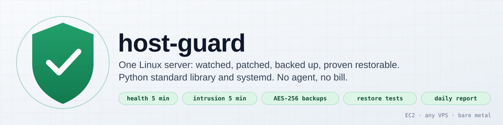
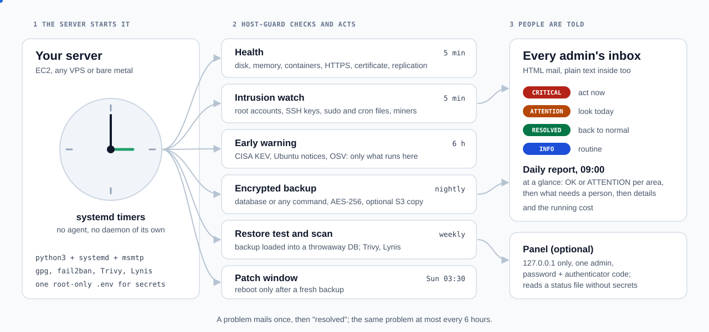
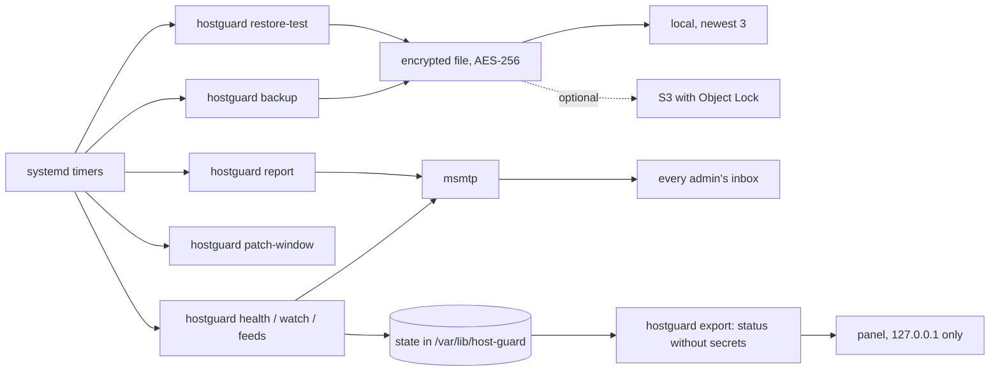

<div align="center">



<a href="docs/assets/host-guard-intro.mp4" title="Watch the 42-second intro with sound (MP4)"></a>

<sub>host-guard in 42 seconds. <a href="docs/assets/host-guard-intro.mp4">Watch with sound (MP4)</a></sub>

**Security, health, backups and early warning for one Linux server.**<br>
For anyone running a product on a single cloud instance, VPS or bare-metal box without a platform team.

[](https://github.com/855princekumar/host-guard/actions/workflows/ci.yml)
[](LICENSE)
[](CHANGELOG.md)
[](https://github.com/855princekumar/host-guard/actions/workflows/codeql.yml)
[](CONTRIBUTING.md)

[](guard/hostguard.py)
[](guard/systemd/)
[](docs/INSTALL.md)
[](docs/CLOUDS.md)

[](.github/workflows/ci.yml)
[](.github/workflows/ci.yml)
[](docs/REDTEAM.md)
[](docs/VERSIONS.md)
[](#why-host-guard)

[Install](docs/INSTALL.md) · [Versions and rollback](docs/VERSIONS.md) · [How it works](docs/HOW-IT-WORKS.md) · [Clouds](docs/CLOUDS.md) · [Mail](docs/MAIL.md) · [Red team](docs/REDTEAM.md) · [Configuration](docs/CONFIGURATION.md) · [Running cost](docs/COST.md) · [Panel](docs/PANEL.md) · [Releasing](docs/RELEASING.md) · [Security](SECURITY.md)

</div>

## Why host-guard

Small products often run on one server. Nobody watches it at night, backups are
"probably fine", and security updates wait until something breaks. Monitoring
suites and security agents cost money, need their own servers, and send data
somewhere else.

host-guard is one Python file (standard library only) and a few systemd timers.
It installs with one command, keeps every secret in one root-only file on the
server, and mails every admin when a person is needed. Nothing leaves the server
except the mail and, if you want, an encrypted backup copy in S3.



## What it does

| Job | How often | What it checks or does | When something is wrong |
|---|---|---|---|
| Health | every 5 min | disk, memory, containers, HTTPS answer, TLS certificate, database replication, backup age, pending reboot, new bans | one alert, then a "resolved" mail |
| Intrusion watch | every 5 min | extra root accounts, new login accounts and SSH keys, changed sudo, SSH, cron and systemd files, rootkit preload, crypto miners, programs in memory-only folders, root SSH from the internet | critical mail at once; extra root accounts locked, miners killed (a copy kept); optional lockdown of the web server |
| Early warning | every 6 h | CISA's exploited vulnerabilities, Ubuntu security notices, OSV advisories for the Python packages in your containers, matched to what runs here | mail with the advisory and the fixed version |
| Backup | nightly | your database (MariaDB or PostgreSQL) or any command's output, gzipped, encrypted with AES-256, checksummed, newest 3 kept, optional S3 copy | alert if the dump, encryption or upload fails |
| Restore test | weekly | the newest backup decrypted and loaded into a throwaway database (or unpacked completely) | alert: a backup that does not restore is no backup |
| Scan | weekly | Trivy on every running image, Lynis on the host | mail with what to fix |
| Patch window | weekly | security updates install daily; the reboot they need happens here, after a fresh backup and only with healthy replication | reboot postponed, with the reason |
| Daily report | daily | at a glance (OK or ATTENTION per area), what needs a person, every detail, the running cost and where it could cost less | problems listed first |

On install it also hardens the base: SSH by key only for one user, fail2ban for
SSH and repeat offenders (and for sign-in floods and probes when you give it the
web logs), kernel network settings, outbound mining ports blocked, automatic
security updates.

## Proven by attack

Every change is attacked in CI before it can merge: 37 real attacks on an isolated
network against a server installed by the version manager, each mapped to MITRE ATT&CK.
**34 stopped or detected, 3 known gaps, 0 failed.**

| Phase | Attacks | Result |
|---|---|---|
| SSH: brute force, password, root, wrong user | 6 | 6 stopped |
| Web: probes for secrets, request floods | 3 | 3 stopped |
| Host: root backdoor, miners, SSH keys, sudoers, cron, preload | 9 | 8 stopped, 1 gap |
| Network: mining-pool egress, port scan | 2 | 1 stopped, 1 gap |
| Backups: theft, tampering of the off-site copy, restore | 4 | 4 stopped |
| Secrets: leaks, file permissions, panel account | 3 | 3 stopped |
| Panel: DNS rebinding, CSRF, SQL injection, cookie theft, code replay, guessing | 10 | 9 stopped, 1 gap |

Known gaps, reported rather than hidden: a miner renamed like a kernel thread, run from /usr/local/bin; a port scan of 20 common ports; stolen session cookie replayed from another browser.
The suite found and fixed four real defects on its first runs.
[Full report, samples of the mails it sent](docs/REDTEAM.md).

## Runs anywhere, sets itself up

The cloud is read from its own metadata service; anything else is a VPS or bare metal.
The installer records it and adapts: the off-site store that fits, the cost estimate
(AWS prices only on AWS), the usual login user.

| | AWS | Google Cloud | Azure | Oracle Cloud | VPS or bare metal |
|---|---|---|---|---|---|
| Detected by | IMDSv2 | `Metadata-Flavor: Google` | `Metadata: true` | `Bearer Oracle` | no metadata service |
| Off-site copy | S3 | Cloud Storage (S3 interop) | Blob (SAS URL) | Object Storage (pre-authenticated URL or S3 API) | any S3-compatible store |
| Tested in CI with | Floci, AWS Emulator | Floci GCP | Azurite | Floci OCI | |

[docs/CLOUDS.md](docs/CLOUDS.md).

## Mail that sorts itself

```
[P1 Critical]  Intrusion    | web-01 | Intrusion signs on the server
[P2 Attention] Attack       | web-01 | Blocked 3 address(es)
[P3 Info]      Backup       | web-01 | Restore test passed
[Daily]        Daily report | web-01 | Daily report: all good
```

Severity, then category, then server, in every subject, plus `List-Id` and
`X-Host-Guard-*` headers for filters. P1 always goes out at once; similar P2 and P3
mails are capped per hour, so an attack does not bury the inbox.
[docs/MAIL.md](docs/MAIL.md).

## Quick start

On the server (Ubuntu 22.04 to 26.04 or Debian 12), with an SSH key that works and a
second session open:

```bash
sudo apt install -y pipx
sudo PIPX_HOME=/opt/pipx PIPX_BIN_DIR=/usr/local/bin pipx install host-guard
sudo host-guard install --mail-to you@gmail.com,teammate@example.com \
     --profile examples/profiles/plain-vps.conf --with-trivy
```

(From a clone instead: `sudo ./host-guard install ...` in the repository folder.)

It asks for the Gmail app password of the first address (not shown as you type),
then sends a test mail. Copy the backup passphrase somewhere offline:
`sudo grep BACKUP_PASSPHRASE /etc/host-guard/.env`.

Pick the profile closest to your server, or start from `plain-vps.conf` and edit
`/etc/host-guard/guard.conf` later:

| Profile | For |
|---|---|
| [plain-vps.conf](examples/profiles/plain-vps.conf) | any VPS or bare-metal box; backs up `/etc` and `/home` |
| [compose-postgres.conf](examples/profiles/compose-postgres.conf) | a Docker Compose app with PostgreSQL |
| [bare-metal-mariadb.conf](examples/profiles/bare-metal-mariadb.conf) | nginx and MariaDB installed on the host |
| [edgeshell.conf](examples/profiles/edgeshell.conf) | [EdgeShell](https://github.com/855princekumar/edgeshell): Compose, MariaDB primary and replica |

Full steps for EC2, a VPS and bare metal, other mail providers and an off-site
S3 copy: [docs/INSTALL.md](docs/INSTALL.md).

### Upgrade, roll back, remove

Every install is recorded file by file in `/opt/host-guard`, so it can be undone exactly:

```bash
sudo host-guard upgrade              # same options as the install
sudo host-guard rollback             # undo the last install (or --to 0.3.0)
sudo host-guard uninstall            # settings, secrets and backups stay
host-guard history
```

A failed install undoes itself; a file you edited since is kept, not overwritten;
SSH settings are checked before they apply. [docs/VERSIONS.md](docs/VERSIONS.md).

## How it fits together



More diagrams (the life of an alert, a night's backup, the weekly rhythm, the
panel's security split): [docs/HOW-IT-WORKS.md](docs/HOW-IT-WORKS.md).

## The panel (optional)

A one-page, read-only view of the same status for one admin: password hashed
with scrypt plus an authenticator code, 127.0.0.1 only (reach it through
`ssh -L`), running as an unprivileged user that cannot read any secret.
[docs/PANEL.md](docs/PANEL.md).

## Everyday commands

| Task | Command |
|---|---|
| Installed version, then status and open problems | `sudo host-guard status` |
| The daily report now | `sudo hostguard report` |
| Check that mail reaches everyone | `sudo hostguard test-mail` |
| When each job runs next | `systemctl list-timers 'host-guard-*'` |
| Back up now / restore test now | `sudo systemctl start host-guard-backup` / `host-guard-restore-test` |
| Unban an address | `sudo fail2ban-client set <jail> unbanip <address>` |
| End a web lockdown | `sudo hostguard unlock` |

## Tests

```bash
python -m pytest -q tests guard/tests panel/tests
docker run --rm -v "$PWD:/src:ro" ubuntu:26.04 bash /src/ci/fresh_install.sh
python ci/build_dist.py && docker run --rm -v "$PWD:/src:ro" -v "$PWD/dist:/dist:ro" debian:12 bash /src/ci/lifecycle.sh
```

| CI job | What it proves |
|---|---|
| Tests (Python 3.10, 3.12, 3.14) | the guard, the panel and the version manager, without root |
| Fresh install (Ubuntu 24.04, 26.04, Debian 12) | a real install, a real `sshd -t`, a rerun, a backup and a restore test |
| Install, upgrade, rollback, uninstall (same three) | the pip package through its whole life; after `uninstall --purge` the server is byte-for-byte as before |
| Database backups and restore tests | real MariaDB and PostgreSQL, restored into throwaway databases |
| Package | sdist and wheel carry what runs on a server; `twine check`; VERSION matches the changelog |
| Red team | 37 real attacks on an isolated network, scored per MITRE ATT&CK; a failed defense fails CI |
| Clouds | AWS, Google Cloud, Azure, Oracle Cloud and bare metal detected; backups off-site to emulated stores and restore-tested; forged signatures refused |
| CodeQL (Python, Actions) | security-extended queries on every change and weekly |
| Lint, Bandit, gitleaks, ShellCheck, systemd units | code quality, security patterns, no secret in the whole history, unit files valid |
| Docs and text | every local link resolves; no em dash |

## Contributing and security

Issues and pull requests are welcome: [CONTRIBUTING.md](CONTRIBUTING.md).
Please report vulnerabilities privately: [SECURITY.md](SECURITY.md).

MIT licensed. Built by [Prince Kumar](https://github.com/855princekumar), first
for the server that runs [EdgeShell](https://github.com/855princekumar/edgeshell).
