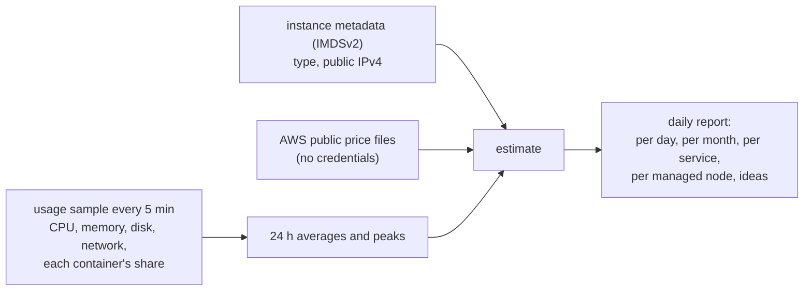

# Running cost

Monitoring tells you the server is healthy; it rarely tells you what it costs or
whether it is too big. host-guard's daily report ends with both, from the same
numbers it already measures.

## What the report shows

```
== Running cost (estimate, AWS list prices published 2026-11-10, ap-south-1)
Instance t3.xlarge (4 vCPU, 16 GB) at $0.1792/h, disk 100 GB, public IPv4 yes
Per day $4.30, per month $131.00
  instance        $112.00 a month
  disk (EBS gp3)  $9.12 a month
  public IPv4     $3.65 a month
  internet egress $5.20 a month
  backups (S3)    $1.03 a month
Per managed node: $10.92 a month (12 nodes)
Usage (24 h): CPU avg 6% peak 31%, memory avg 16% peak 22%, disk used 21 GB, internet egress 1.6 GB/day
Instance and disk by service (half CPU, half memory share):
  app            $48.10 a month   (CPU 3.1%, memory 1850 MB)
  db             $41.70 a month   (CPU 1.9%, memory 1600 MB)
Where it could cost less:
  Smaller: peak CPU 31%, peak memory 3.5 GB of 16; t3.large (8 GB) is $56.06 a month
  Savings Plans or reserved instances lower the instance price for a 1 or 3 year commitment (AWS Pricing Calculator)
```

(Example figures.) It is an estimate from list prices: no billing access, no
credentials, no Cost Explorer charges.

## How it is worked out



| Line | From |
|---|---|
| Instance | the instance type (metadata, or `INSTANCE_TYPE`) at the region's on-demand price, or `PRICE_HOUR` |
| Disk | the root volume's size (or `EBS_GB`) at the gp3 price |
| Public IPv4 | AWS charges for every public IPv4 address; on when the instance has one (`PUBLIC_IPV4=auto`) |
| Internet egress | measured bytes out of the network interface |
| Backups (S3) | the newest backup's size times `S3_RETENTION_DAYS` copies, when `S3_BUCKET` is set |
| Per service | instance and disk split by each container's measured share (half CPU, half memory) |
| Per managed node | only for EdgeShell, with `EDGESHELL_KEY` set |

The ideas compare the measured peaks with a smaller type that still leaves room
(memory at least 1.5 times the peak), the Graviton (arm64) type of the same size,
and a Lightsail plan of the same size, each with its monthly price, and point to
Savings Plans and Reserved Instances.

## Outside AWS

Set what your plan costs and zero what it includes, in `/etc/host-guard/guard.conf`:

```ini
# a VPS at 24.00 a month: 24 / 730 hours
PRICE_HOUR=0.0329
PUBLIC_IPV4=no
PRICE_EBS_GB_MONTH=0
PRICE_EGRESS_GB=0
# show rupees as well
USD_INR=88
```

The usage figures and the per-service split work the same everywhere; the
size ideas are written for AWS instance types.

## Using it to cut the bill

1. Let a week of reports come in: averages and peaks need normal weekly traffic.
2. If the peaks stay well under half of the instance, try the suggested smaller
   type in a quiet hour (stop, change type, start; take a backup first).
3. Commit only after a week on the new size: then a Savings Plan or Reserved
   Instance lowers the price further for a 1 or 3 year term.
4. Keep watching the report: if memory or CPU peaks climb after the change, the
   health check will tell you before users do.
