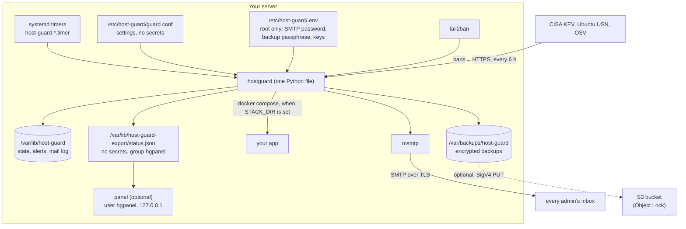
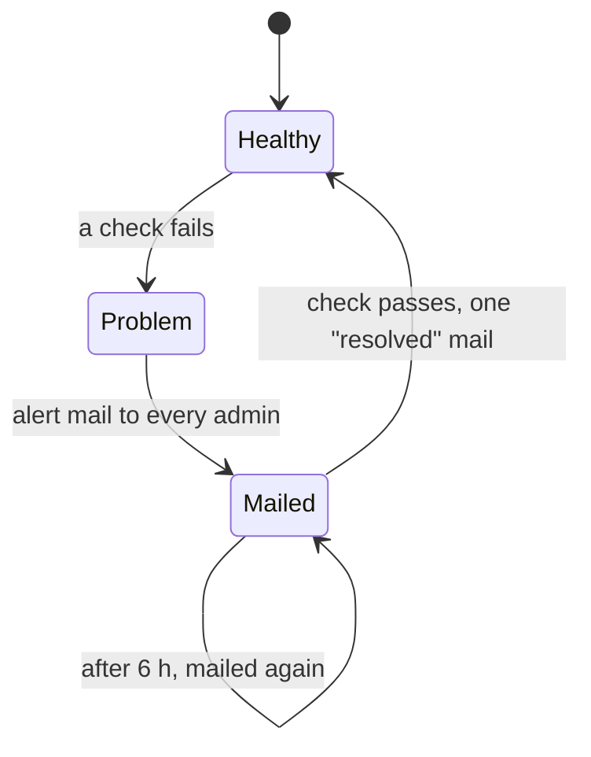
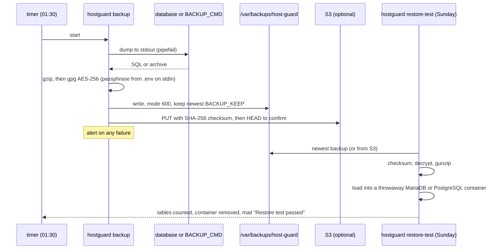
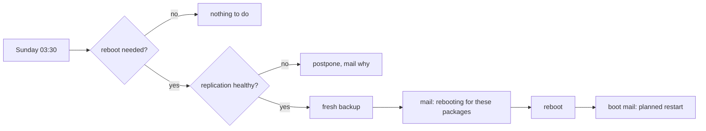
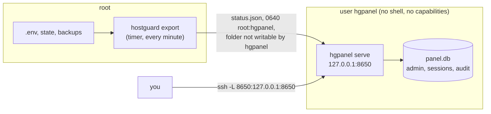

# How host-guard works

host-guard is one program, `/usr/local/sbin/hostguard` (Python 3, standard library
only), started by systemd timers. Each job runs, writes what it found to
`/var/lib/host-guard`, mails when a person is needed, and exits. There is no
daemon of its own and nothing to keep running.

## The parts

## The weekly rhythm

| When (server time zone) | Timer | What happens |
|---|---|---|
| every 5 min | `host-guard-health` | health checks, new bans, a usage sample for the cost report |
| every 5 min | `host-guard-watch` | intrusion watch |
| every 6 h | `host-guard-feeds` | early warning |
| nightly from 01:30 (random delay) | `host-guard-backup` | the encrypted backup |
| daily 09:00 (`--report-time`) | `host-guard-report` | the daily report |
| Sunday from 02:00 (random delay) | `host-guard-scan` | Trivy and Lynis |
| Sunday 03:30 (`--maintenance`) | `host-guard-patch-window` | reboot for updates, if needed and safe |
| Sunday 04:30 | `host-guard-restore-test` | restore test of the newest backup |
| after every boot | `host-guard-boot` | a mail saying whether the restart was planned |

Timers are `Persistent=true`: a job missed while the server was off runs when it
comes back.

## The life of an alert

Each problem has a key (`disk`, `containers`, `replication`, ...). The key stays
open in `alerts.json` until the check passes, so the daily report can list what is
still open under "Needs attention".

## A night's backup and the weekly proof

What gets backed up depends on [the settings](CONFIGURATION.md#backups):
`DB_ENGINE=mariadb` or `postgres` dumps every database (inside the Compose
service `DB_SERVICE`, or on the host); `BACKUP_CMD` backs up anything that can be
written to stdout, for example `tar -cf - /etc /srv/data`.

## The patch window

Security updates themselves install every day (unattended-upgrades); host-guard
switches off their automatic reboot so the reboot only ever happens here.

## What the intrusion watch looks at

| Sign | How | What host-guard does by itself |
|---|---|---|
| A second account with UID 0 | `/etc/passwd` | **locks it and kills its processes**, critical mail |
| A new account that can log in | `/etc/passwd` compared with the last run | alert with the command to lock it |
| A rootkit preload | `/etc/ld.so.preload` is set | critical mail |
| A crypto miner | process names and executables against known miners | **kills it**, keeps a copy of the program for you, critical mail |
| A program running from a memory-only folder | executables under `/dev/shm` or `/run/shm` | alert |
| A new SSH key for the login user (`LOGIN_USER`) | that user's `authorized_keys`, compared with the last run | alert (the key is not removed: it may be yours) |
| Root logging in over SSH from the internet | the SSH journal | critical mail |
| Changed login, sudo, SSH, cron or systemd files | SHA-256 of `/etc/passwd`, `/etc/shadow`, `/etc/group`, `/etc/sudoers*`, `/etc/ssh/sshd_config*`, `/root/.ssh/authorized_keys`, cron files, systemd units, `/etc/rc.local`, `/etc/ld.so.preload` | alert listing the files (normal after updates or your own edits) |

The first run records a baseline and mails nothing. After that, a critical sign
mails at once; with `LOCKDOWN=web` it also stops the web server
(`WEB_SERVICE`) until `sudo hostguard unlock`.

## The panel's security split

The panel never reads a secret and cannot write anything root reads. Details:
[PANEL.md](PANEL.md).

## Mail

msmtp sends through your SMTP account (Gmail or Google Workspace with an app
password by default). Its configuration holds no password: `passwordeval` reads it
from `.env` at send time. Every mail has a plain-text part and an HTML part with a
coloured banner (Critical, Attention, Resolved, Information), tables and bullet
points. Everything the server reports is escaped before it goes into the HTML,
and a subject can never add a mail header.
