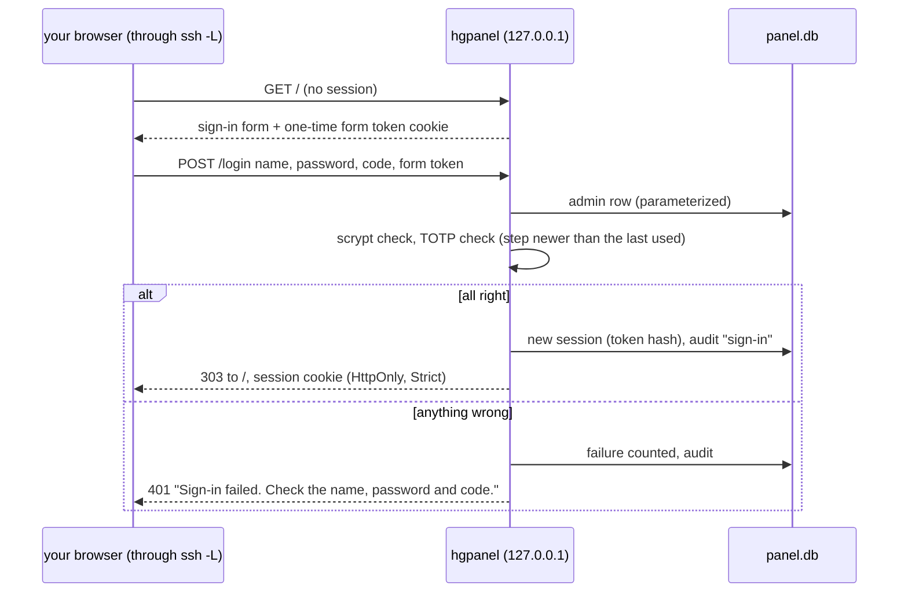

# The panel

One page with everything host-guard knows (health, intrusion watch, bans, backup,
restore test, scan, early warning, open problems, recent mails), for one admin.
Read-only in this version: changes are made on the server.

Python 3 standard library and one SQLite file. No framework, no JavaScript.

## Install

host-guard must be installed first.

```bash
sudo bash panel/install.sh                     # user hgpanel, the service, the export timer
sudo -u hgpanel python3 /usr/local/lib/host-guard-panel/hgpanel.py init-admin yourname
```

`init-admin` asks for a password twice (12 characters at least, not shown) and
prints an authenticator key once, in your terminal only. Add it to any TOTP app
(Google Authenticator, 1Password, Aegis, ...) and type the code it shows to
confirm. `--reset` replaces the admin and signs everyone out.

## Open it

The panel listens on `127.0.0.1:8650` only. From your computer:

```bash
ssh -L 8650:127.0.0.1:8650 you@your-server
```

then open http://127.0.0.1:8650. The base hardening keeps SSH local forwarding
on for this (`AllowTcpForwarding local`); if another policy on the server turns
it off, use a private network instead: on a Tailscale or WireGuard address, set
`BIND` to that address, `ALLOW_REMOTE=1` and `ALLOWED_HOSTS=<address>:8650` in
`/etc/host-guard-panel/panel.conf`. Never put the panel on a public address.

## Security model

| Concern | How it is handled |
|---|---|
| Exposure | 127.0.0.1 by default; any other address is refused unless set on purpose; the `Host` header must match (no DNS rebinding) |
| Privilege | runs as `hgpanel`: no shell, no home, no capabilities, read-only system, private /tmp, system-call filter (`systemd-analyze security` exposure about 1.3) |
| Secrets | cannot read `/etc/host-guard`, `/var/lib/host-guard` or the backups (also blocked in the unit); root's `hostguard export` writes a status file without secrets into a folder the panel can read but not write |
| Admins | the table holds one row; password hashed with scrypt (N=2^15) |
| Second factor | TOTP (RFC 6238), 30 s steps, a code works once (replay refused) |
| Guessing | 5 failures lock the account for 15 minutes; 10 failures from one address in 15 minutes block that address; the message never says which part was wrong |
| Sessions | 256-bit random token, only its SHA-256 stored; cookie HttpOnly, SameSite=Strict, Secure; 15 minutes idle, 8 hours at most; a new token at every sign-in |
| Web | a CSRF token on every form; parameterized SQL only; every value HTML-escaped; Content-Security-Policy `default-src 'none'` (no script at all); no framing; `no-store`; 8 KB request limit |
| Audit | sign-ins, failures, lockouts, blocked addresses and sign-outs, at `/audit` or `hgpanel audit` |



## Settings

`/etc/host-guard-panel/panel.conf` (`KEY=value`; environment `HGP_<KEY>` wins):

| Key | Default | What |
|---|---|---|
| `BIND` | `127.0.0.1` | listening address |
| `PORT` | `8650` | listening port |
| `ALLOW_REMOTE` | `0` | `1` allows a non-loopback `BIND` |
| `ALLOWED_HOSTS` | empty | extra accepted `Host` headers, comma separated |
| `COOKIE_SECURE` | `1` | browsers accept Secure cookies on 127.0.0.1 and localhost |
| `IDLE_MIN`, `MAX_HOURS` | `15`, `8` | session limits |
| `LOCK_AFTER`, `LOCK_MIN`, `IP_LIMIT` | `5`, `15`, `10` | lockout and per-address limits |
| `DB`, `STATUS_FILE` | `/var/lib/host-guard-panel/panel.db`, `/var/lib/host-guard-export/status.json` | files |

## Roadmap

1. Read-only panel (this version).
2. Settings from the panel (recipients, thresholds, schedule), with secrets
   write-only, through a root helper that accepts a fixed list of actions and
   checks every value.
3. Quick actions through the same helper (test mail, back up now, restore test,
   unban an address, end a lockdown), each confirmed with a fresh code and audited.
4. Anomaly detection from statistics on host-guard's own numbers, with a baseline
   per hour of the week.
5. Optionally, a small local language model that explains findings and suggests
   an action, and never acts on its own (log text can carry an attacker's words).
