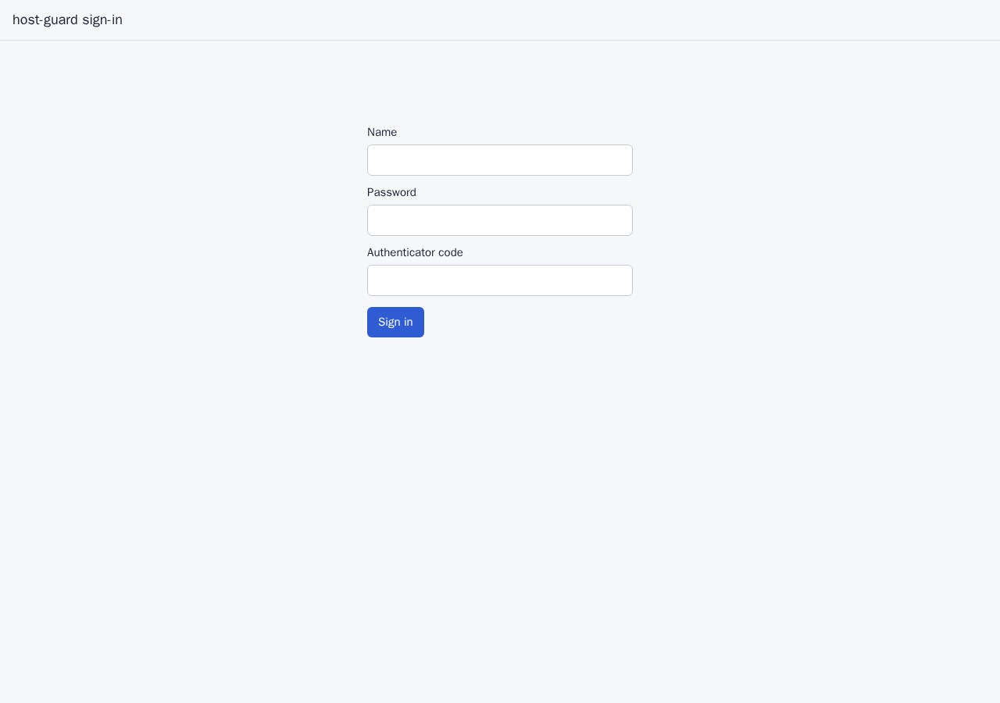
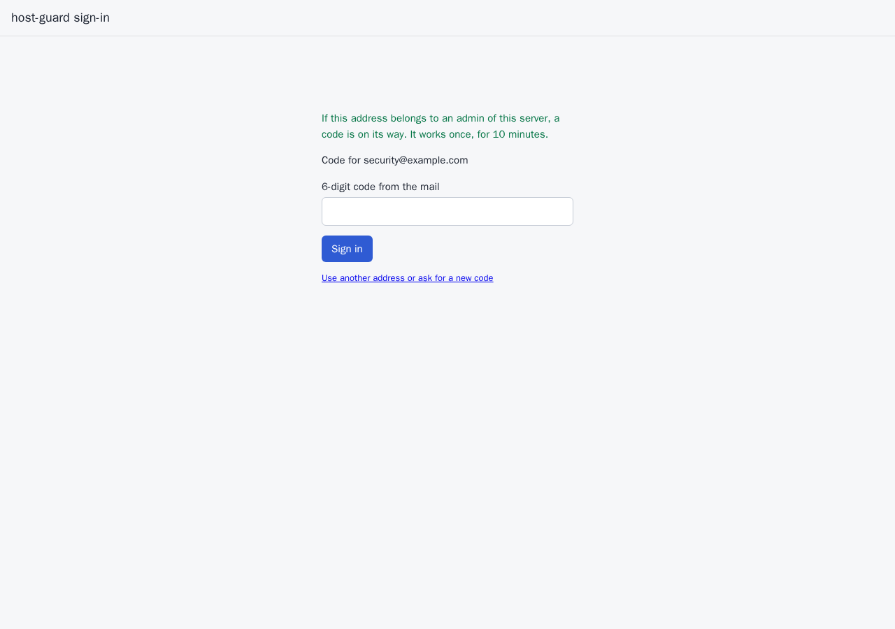
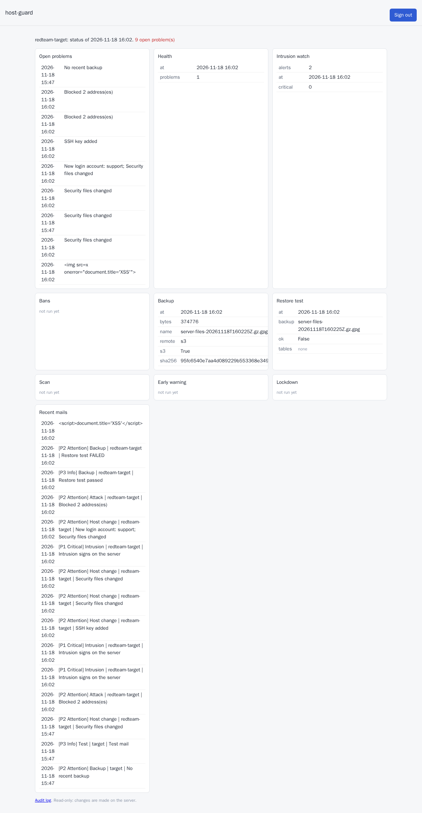
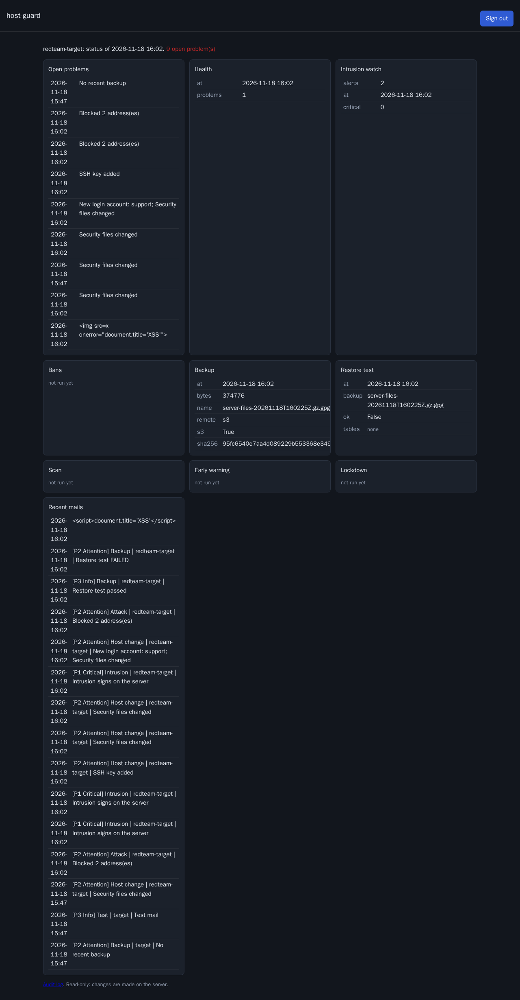
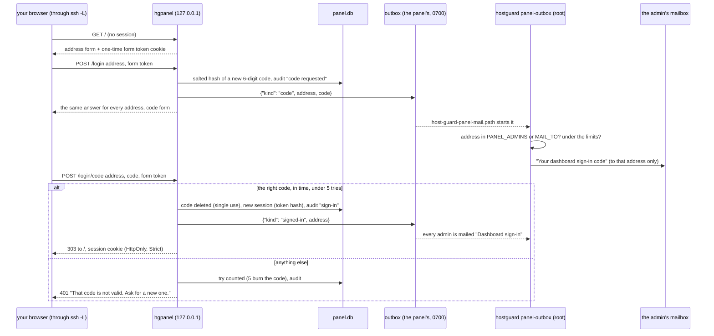

# The panel

One page with everything host-guard knows (health, intrusion watch, bans, backup,
restore test, scan, early warning, open problems, recent mails), for the admins.
Three changes can be made from it, each confirmed with a fresh code mailed to the admin and
mailed to every admin when done:
- [advisory sources](ADVISORIES.md#sources);
- **Fix now** and **Hold** on a Critical or Moderate finding;
- **Approve a reboot now** ([approvals](APPROVALS.md); a reboot needs two admins).

Everything else is changed on the server.

**No password.** An admin types their email address, gets a 6-digit code at that address,
and signs in with it. The admins are the addresses host-guard already mails (`--mail-to` at
install, `MAIL_TO` in `/etc/host-guard/guard.conf`), or `PANEL_ADMINS` there when only some
of them should see the dashboard.

Python 3 standard library and one SQLite file. No framework, no JavaScript.

## Install

host-guard must be installed first.

```bash
sudo host-guard install --mail-to you@example.com,ops@example.com ... --with-panel
# or later: sudo host-guard upgrade --with-panel
```

(Without the version manager: `sudo bash panel/install.sh`.) Nothing else to set up: the
admins are the `--mail-to` addresses. To let only some of them in, add
`PANEL_ADMINS=you@example.com` to `/etc/host-guard/guard.conf`.

## Sign in

1. Open the dashboard (below) and type your address: **Send me a sign-in code**.
2. A mail *Your dashboard sign-in code* arrives at that address only, with a 6-digit code.
3. Type the code. It works once, for 10 minutes.

Every sign-in is mailed to all admins (*Dashboard sign-in: you@example.com*), so a sign-in
nobody expected is seen at once.

<p align="center">


</p>

## Open it

The panel listens on `127.0.0.1:8650` only: nothing on the internet can reach it, and no
port has to be opened. You bring it to your own computer through a tunnel, then open
**http://127.0.0.1:8650** in your browser. Pick the tunnel that fits the server:

| Where the server runs | Command on your computer | Needs |
|---|---|---|
| Any server you reach by SSH | `ssh -N -L 8650:127.0.0.1:8650 you@your-server` | your SSH key (host-guard keeps `AllowTcpForwarding local` on for this) |
| AWS, without opening SSH at all | `aws ssm start-session --target i-0123456789abcdef0 --document-name AWS-StartPortForwardingSession --parameters portNumber=8650,localPortNumber=8650` | the SSM agent and an instance role with `AmazonSSMManagedInstanceCore` |
| Google Cloud | `gcloud compute start-iap-tunnel VM_NAME 8650 --local-host-port=localhost:8650 --zone ZONE` | IAP TCP forwarding allowed to the VM (firewall rule from 35.235.240.0/20) |
| Azure | `az network bastion tunnel --name BASTION --resource-group RG --target-resource-id VM_ID --resource-port 8650 --port 8650` | Azure Bastion, Standard SKU or higher |
| Oracle Cloud | a Bastion port-forwarding session to the instance's port 8650, then the `ssh -N -L 8650:...` command the console shows | OCI Bastion |
| Tailscale or WireGuard | `BIND=<private address>`, `ALLOW_REMOTE=1`, `ALLOWED_HOSTS=<address>:8650` in `/etc/host-guard-panel/panel.conf`, then open `http://<address>:8650` | the private network; never a public address |

Every route ends in the same place: your browser talks to `127.0.0.1:8650` on your own
computer, which the tunnel carries to `127.0.0.1:8650` on the server. Whoever cannot open
the tunnel cannot even see the sign-in page; whoever can still needs a code from an admin's
mailbox.

<p align="center">

</p>
<p align="center"></p>

<sub>Screenshots taken by the red team's browser stage in CI (a real headless Chromium,
signed in through the panel's own form), with the red team's attack traffic in the data.</sub>

## Security model

| Concern | How it is handled |
|---|---|
| Exposure | 127.0.0.1 by default; any other address is refused unless set on purpose; the `Host` header must match (no DNS rebinding) |
| Privilege | runs as `hgpanel`: no shell, no home, no capabilities, read-only system, private /tmp, system-call filter (`systemd-analyze security` exposure about 1.3) |
| Secrets | cannot read `/etc/host-guard`, `/var/lib/host-guard` or the backups (also blocked in the unit); root's `hostguard export` writes a status file without secrets into a folder the panel can read but not write |
| Who may sign in | only the admin addresses (`PANEL_ADMINS`, else `MAIL_TO`), decided by root, not by the panel: the panel never learns the list, so it answers every address the same way and nobody can find out which addresses are admins |
| Codes | 6 random digits; only a salted SHA-256 is stored; single use; 10 minutes; usable only in the browser that asked for it (an `hg_ask` cookie), so nobody else can replace, burn or use an admin's code; 5 wrong tries burn it, counted even while guessing is blocked; 3 requests per browser and address, 10 per address, in 10 minutes |
| Mailing | the panel cannot read the mail password: it leaves the request in its outbox (`/var/lib/host-guard-panel/outbox`, its own, 0700) and the root service `host-guard-panel-mail.path` runs `hostguard panel-outbox` (sandboxed by systemd), which mails a code only to that admin, at most 5 per address in 15 minutes and 30 an hour (sign-in notices: 5 per address, 20 an hour); it opens the outbox once, refuses it unless it is a 0700 folder of the panel's user, and reads and removes entries only through that open folder (a link put in place of the outbox reaches nothing), reads only small regular files of the panel's user and removes every entry; so even a panel that was taken over cannot mail anyone but the admins, mail them much, or touch anything outside its outbox |
| Guessing | 10 failures in 15 minutes block further guesses (every visitor arrives through the tunnel as 127.0.0.1, so the right code still gets in: nobody can lock the admins out this way) |
| Notice | every sign-in is mailed to all admins |
| Sessions | 256-bit random token, only its SHA-256 stored; cookie HttpOnly, SameSite=Strict, Secure; 15 minutes idle, 8 hours at most; a new token at every sign-in |
| Web | a CSRF token on every form; parameterized SQL only; every value HTML-escaped; Content-Security-Policy `default-src 'none'` (no script at all); no framing; `no-store`; 8 KB request limit |
| Cross-site | a form post whose `Origin` is another site, or that the browser marks `Sec-Fetch-Site: cross-site`, is refused and audited; no CORS header is ever sent |
| Audit | code requests (with the address), sign-ins, failures, burned codes, blocked guesses, cross-site posts and sign-outs, at `/audit` or `hgpanel audit` |
| Tested | every change: unit tests, plus the red team in CI with raw HTTP and a real browser (sign-in with the code read from the mailbox, address enumeration, code flooding, a taken-over panel feeding the root mailer, session fixation, stored script injection, CORS reads, cross-site posts, framing, unusual methods, path traversal, guessing, code replay); see [REDTEAM.md](REDTEAM.md) |



## Advisories and approvals

**Advisories and approvals** (`/advisories`) lists:
- the open Critical and Moderate findings, with **Fix now** and **Hold** where an automatic
  fix exists;
- a pending reboot, with **Approve a reboot now**;
- what waits for a second admin;
- the **Approvals log**: who approved what, by email reply, on the dashboard or on the
  server.

A button never acts by itself:
1. The panel mails the admin a code naming that one change (*Your code to confirm a dashboard
   change*).
2. Only that code, in that session, sends it on.
3. Root then checks it again: a known action, an admin, at most 10 changes an hour, and two
   admins for a reboot.

A stolen session cookie alone changes nothing.

## Settings

`/etc/host-guard-panel/panel.conf` (`KEY=value`; environment `HGP_<KEY>` wins):

| Key | Default | What |
|---|---|---|
| `BIND` | `127.0.0.1` | listening address |
| `PORT` | `8650` | listening port |
| `ALLOW_REMOTE` | `0` | `1` allows a non-loopback `BIND` |
| `ALLOWED_HOSTS` | empty | extra accepted `Host` headers, comma separated |
| `COOKIE_SECURE` | `1` | browsers accept Secure cookies on 127.0.0.1 and localhost |
| `IDLE_MIN`, `MAX_HOURS` | `15`, `8` | session limits |
| `CODE_MIN`, `CODE_TRIES`, `CODE_REQUESTS`, `CODE_REQUESTS_ALL` | `10`, `5`, `3`, `10` | a code's life in minutes, wrong tries before it is burned, requests per browser and address, and per address in all, in 10 minutes |
| `LOCK_MIN`, `IP_LIMIT` | `15`, `10` | failures in that many minutes that block further guesses |
| `DB`, `STATUS_FILE`, `OUTBOX` | `/var/lib/host-guard-panel/panel.db`, `/var/lib/host-guard-export/status.json`, `/var/lib/host-guard-panel/outbox` | files |

Who the admins are is a host-guard setting, not a panel one: `PANEL_ADMINS` in
`/etc/host-guard/guard.conf` (empty: every `MAIL_TO` address).

## Roadmap

1. Read-only panel; advisory sources, fix, hold and reboot approvals with a fresh code
   (this version).
2. Settings from the panel (recipients, thresholds, schedule), with secrets
   write-only, through a root helper that accepts a fixed list of actions and
   checks every value.
3. Quick actions through the same helper (test mail, back up now, restore test,
   unban an address, end a lockdown), each confirmed with a fresh code and audited.
4. Anomaly detection from statistics on host-guard's own numbers, with a baseline
   per hour of the week.
5. Optionally, a small local language model that explains findings and suggests
   an action, and never acts on its own (log text can carry an attacker's words).
