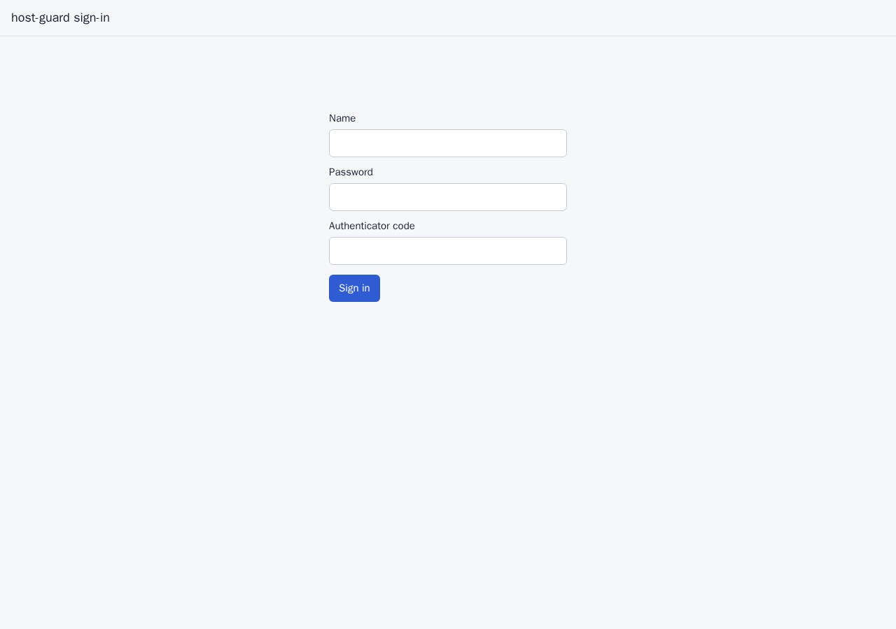
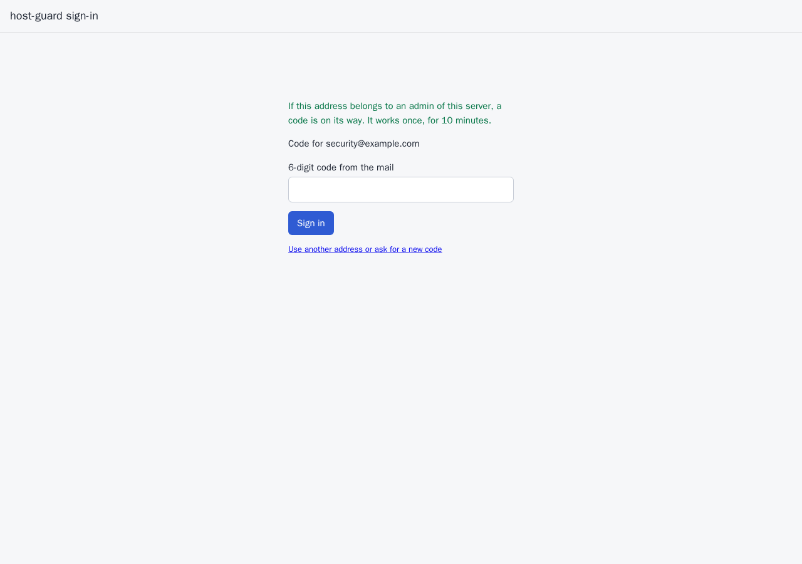
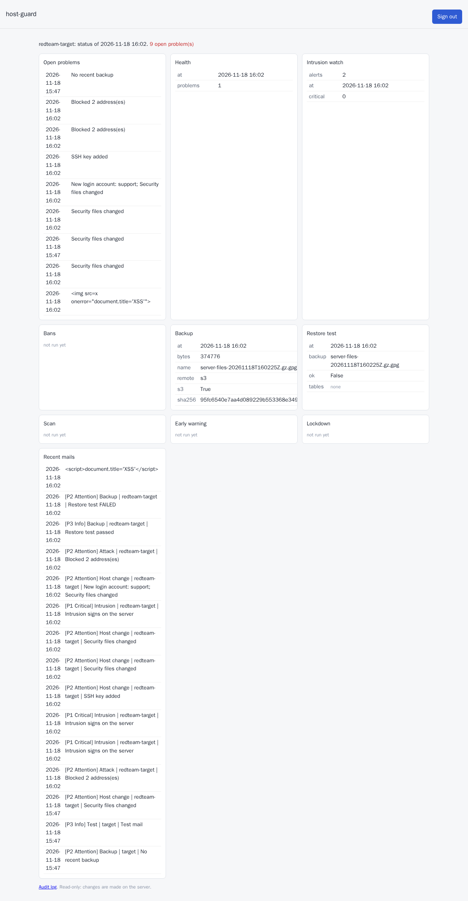

# Red team

Every change to host-guard is attacked before it can merge. CI builds a server with
host-guard installed by its version manager, then attacks it from separate containers on
an isolated network, and attacks the dashboard from a real browser (headless Chromium)
the way a hostile web page would: 67 attacks, each mapped to a
[MITRE ATT&CK](https://attack.mitre.org/) technique and scored **stopped** (the defense
worked as designed), **gap** (a known limitation, reported and planned) or **failed**
(a defense did not work: CI fails and nothing merges or releases).

Run it yourself: `bash ci/redteam/run.sh` (Docker needed; results in `redteam-out/`).

| Part | File |
|---|---|
| The run: network, containers, every attack and its expected defense | [ci/redteam/run.sh](../ci/redteam/run.sh) |
| The target: Ubuntu with sshd, nginx and host-guard installed by the version manager | [ci/redteam/target.sh](../ci/redteam/target.sh) |
| Dashboard attacks over raw HTTP | [ci/redteam/panel_attack.py](../ci/redteam/panel_attack.py) |
| Dashboard in a real browser, and a hostile page in the same browser | [ci/redteam/browser_attack.py](../ci/redteam/browser_attack.py) |
| The report | [ci/redteam/report.py](../ci/redteam/report.py) |

## What the red team found and fixed

| Found by | Defect | Fix |
|---|---|---|
| HOST-1 | A second root account made the watch run `pkill -u NAME`, which matches UID 0: every root process died (sshd, Docker, the web server, host-guard itself) and no mail went out | the account is locked and only its own SSH logins end |
| WEB-1 | The `web-probe` jail never banned: fail2ban cuts the time stamp out of a line before matching and leaves `[]`, which the filter did not accept | the filter accepts empty brackets |
| HOST-8 | Loader warnings caused by `/etc/ld.so.preload` were read as a root SSH login from the internet (a false critical alert) | only sshd's real "Accepted ... for root from ADDRESS" lines count |
| HOST-9 | Flood protection held a new-login-account alert after four noisy changes in the hour: an intruder could bury the alert that matters | `Intrusion` and `Host change` mails are never held |
| GUI-2 | A new cross-site check refused the admin's own sign-in: Chrome sends `Origin: null` on a same-origin form under `Referrer-Policy: no-referrer` | `Origin: null` is judged by the browser's own `Sec-Fetch-Site` |
| MAIL-5 | An action line with more after the code (`HOLD hg-...; touch /tmp/x`) was taken as the action, the rest ignored (nothing was run) | the line must be the action and the code alone, or it is refused as not understood |

## The dashboard, as the browser stage saw it

<p align="center">



</p>

The planted `<script>` and `` payloads appear in the dashboard as plain text
(PANEL-12): escaped, and a Content-Security-Policy without any script would stop them anyway.

## Sample report

Sample run, 24 min 32 s. Target: Ubuntu 24.04 with host-guard installed by its version manager (plain VPS profile, panel, off-site copies to an emulated S3), attacked from separate containers on an isolated network.

| Result | Count |
|---|---|
| Stopped or detected as designed | 64 |
| Known gaps (reported, planned) | 3 |
| Failed defenses | 0 |

## SSH: initial access

| ID | ATT&CK | Attack | Expected defense | Result | Evidence |
|---|---|---|---|---|---|
| SSH-1 | [T1110.001](https://attack.mitre.org/techniques/T1110/001/) | Log in with the right password | refused: keys only | stopped | exit 255: ops@target: Permission denied (publickey). |
| SSH-2 | [T1078.003](https://attack.mitre.org/techniques/T1078/003/) | Log in as root with root's own valid key | refused: no root login | stopped | exit 255: root@target: Permission denied (publickey). |
| SSH-3 | [T1078.003](https://attack.mitre.org/techniques/T1078/003/) | Log in as a real user with a valid key who is not the admin | refused: one allowed user | stopped | exit 255:  |
| SSH-4 | [T1110.001](https://attack.mitre.org/techniques/T1110/001/) | SSH brute force (8 user names) | address banned, port 22 closed to it | stopped | 172.20.0.4 banned by the sshd jail 902s after the first try; port 22 from it: refused |
| SSH-5 | [T1499](https://attack.mitre.org/techniques/T1499/) | The legitimate admin logs in during the attack | works (bans are per address) | stopped | admin key login: logged-in |
| SSH-6 | [T1110](https://attack.mitre.org/techniques/T1110/) | The admins learn about the ban | mail with the address and the reason | stopped | mail: Subject: [P2 Attention] Attack \| redteam-target \| Blocked 2 address(es) |

## Web: probing and flooding

| ID | ATT&CK | Attack | Expected defense | Result | Evidence |
|---|---|---|---|---|---|
| WEB-1 | [T1595.003](https://attack.mitre.org/techniques/T1595/003/) | Probe for secrets and admin pages (.env, .git, wp-login, phpMyAdmin, .aws) | address banned for a day, site closed to it | stopped | answers: 404 404 404 404 404 ; 172.20.0.5 banned by web-probe; site from it: refused |
| WEB-2 | [T1498.001](https://attack.mitre.org/techniques/T1498/001/) | Request flood (150 requests as fast as possible) | rate limit answers 503, then the address is banned | stopped | answers:  81 000 12 200 57 503 ; 172.20.0.6 banned by nginx-limit-req |
| WEB-3 | [T1499](https://attack.mitre.org/techniques/T1499/) | A normal visitor during the attacks | served | stopped | HTTP 200 |

## Host: persistence, privilege, miners

| ID | ATT&CK | Attack | Expected defense | Result | Evidence |
|---|---|---|---|---|---|
| HOST-1 | [T1136.001](https://attack.mitre.org/techniques/T1136/001/) | A second root account (UID 0) named sysbackup | locked at once, critical mail | stopped | account status: L; critical mail: yes |
| HOST-2 | [T1496](https://attack.mitre.org/techniques/T1496/) | A crypto miner (xmrig) started from /tmp | killed, binary quarantined, critical mail | stopped | still running: no; quarantined copies: 1 |
| HOST-3 | [T1036.005](https://attack.mitre.org/techniques/T1036/005/) | A program with a harmless name running from /dev/shm | killed (memory-only folder), critical mail | stopped | still running: no |
| HOST-4 | [T1036.004](https://attack.mitre.org/techniques/T1036/004/) | A miner renamed like a kernel thread, run from /usr/local/bin | detected | gap | still running: 8458. Detection is by name and location; CPU and behaviour anomalies are planned |
| HOST-5 | [T1098.004](https://attack.mitre.org/techniques/T1098/004/) | An extra SSH key added for the admin user | alert mail naming the key | stopped | mail names the key: yes |
| HOST-6 | [T1548.003](https://attack.mitre.org/techniques/T1548/003/) | A sudoers rule giving another user root | alert mail naming the file | stopped | mail names /etc/sudoers.d/zz-maint: yes |
| HOST-7 | [T1053.003](https://attack.mitre.org/techniques/T1053/003/) | A cron job that downloads and runs a script | alert mail naming the file | stopped | mail names /etc/cron.d/sys-update: yes |
| HOST-8 | [T1574.006](https://attack.mitre.org/techniques/T1574/006/) | A library preloaded into every program (/etc/ld.so.preload) | critical mail | stopped | critical mail: yes |
| HOST-9 | [T1136.001](https://attack.mitre.org/techniques/T1136/001/) | A new account that can log in (support), after four noisy changes this hour | alert mail, never held by flood protection | stopped | mail: yes |

## Network: egress and scanning

| ID | ATT&CK | Attack | Expected defense | Result | Evidence |
|---|---|---|---|---|---|
| NET-1 | [T1496](https://attack.mitre.org/techniques/T1496/) | A miner on the server reaches its pool (port 3333) | outbound refused; other ports work | stopped | port 3333: refused; port 8443 (control): open |
| NET-2 | [T1046](https://attack.mitre.org/techniques/T1046/) | A port scan of 20 common ports | detected and mailed | gap | no scan detection yet (closed ports are not logged); planned with the anomaly release |

## Backups: confidentiality and integrity

| ID | ATT&CK | Attack | Expected defense | Result | Evidence |
|---|---|---|---|---|---|
| BAK-1 | [T1530](https://attack.mitre.org/techniques/T1530/) | Read the backups (local disk and the off-site S3 copy) | encrypted (AES-256), off-site copy present | stopped | files with readable /etc/passwd lines: none; S3 copy of server-files-20261124T101736Z.gz.gpg: HTTP 200 |
| BAK-2 | [T1005](https://attack.mitre.org/techniques/T1005/) | A local user copies the backup files | root only (mode 600) | stopped | modes: 600 root  |
| BAK-3 | [T1490](https://attack.mitre.org/techniques/T1490/) | Is the off-site backup restorable? | downloaded from S3, decrypted, unpacked | stopped | restore-test: ok |
| BAK-4 | [T1565.001](https://attack.mitre.org/techniques/T1565/001/) | Ransomware or an insider corrupts the off-site copy | restore test fails and mails | stopped | object rewritten (GET, PUT): 200 200; restore test: restore-test: FAILED; mail: yes |

## Secrets

| ID | ATT&CK | Attack | Expected defense | Result | Evidence |
|---|---|---|---|---|---|
| SEC-1 | [T1552.001](https://attack.mitre.org/techniques/T1552/001/) | Look for the backup passphrase and the S3 key outside .env (state, export, mails, logs, manifests) | found nowhere | stopped | files containing a secret: none |
| SEC-2 | [T1552.001](https://attack.mitre.org/techniques/T1552/001/) | The panel's account (if the panel were taken over) reads the secrets or the backups | permission denied | stopped | cat: /etc/host-guard/.env: Permission denied ls: cannot open directory '/var/backups/host-guard': Permission denied  |
| SEC-3 | [T1083](https://attack.mitre.org/techniques/T1083/) | File permissions of secrets, settings and the panel's status file | .env and guard.conf 600 root; status 640 root:hgpanel | stopped | 600 root:root 600 root:root 640 root:hgpanel  |

## Panel in a real browser

| ID | ATT&CK | Attack | Expected defense | Result | Evidence |
|---|---|---|---|---|---|
| GUI-1 | [T1078](https://attack.mitre.org/techniques/T1078/) | The sign-in page in a browser | only an email address: no password field | stopped | email form shown; screenshot panel-signin.png |
| GUI-2 | [T1078](https://attack.mitre.org/techniques/T1078/) | An admin signs in with their address and the code mailed to it, in a real browser | the dashboard: open problems, health, backup and the rest | stopped | code read from the mailbox: True; signed in: True; screenshots panel-signin-code.png, panel-dashboard.png |

## Panel: web attacks (raw HTTP, a hostile page in the same browser, the root mailer)

| ID | ATT&CK | Attack | Expected defense | Result | Evidence |
|---|---|---|---|---|---|
| PANEL-1 | [T1557](https://attack.mitre.org/techniques/T1557/) | DNS rebinding: a page on evil.example reaches the panel through the browser | request refused (Host header checked) | stopped | HTTP 400 for Host: evil.example |
| PANEL-2 | [T1185](https://attack.mitre.org/techniques/T1185/) | Clickjacking, script injection, cached pages | CSP without script, no framing, nosniff, no-store | stopped | all present |
| PANEL-3 | [T1185](https://attack.mitre.org/techniques/T1185/) | Cross-site code request (forged form token) | refused, no code mailed | stopped | HTTP 403; codes mailed: 0 |
| PANEL-4 | [T1190](https://attack.mitre.org/techniques/T1190/) | SQL injection in the address and the code | refused as not an address / not a code; no error, no session | stopped | address: HTTP 400; code: HTTP 401 |
| PANEL-18 | [T1589.002](https://attack.mitre.org/techniques/T1589/002/) | Find out which addresses are admins (ask for a code for an admin and for anyone else) | the same answer for both; a code only ever goes to an admin | stopped | same page and status: True; mails to the outsider: 0 |
| PANEL-5 | [T1539](https://attack.mitre.org/techniques/T1539/) | Session cookie theft by script or cross-site request | HttpOnly, SameSite=Strict, Secure | stopped | code from the mailbox: True; HTTP 303; cookie flags: Path=/; HttpOnly; SameSite=Strict; Secure |
| PANEL-21 | [T1078](https://attack.mitre.org/techniques/T1078/) | A sign-in by someone who got hold of an admin's mailbox | every admin is mailed about every sign-in | stopped | sign-in notices mailed: 1 |
| PANEL-6 | [T1550.004](https://attack.mitre.org/techniques/T1550/004/) | Stolen session cookie replayed from another browser | detected or refused (session bound to the browser, anomaly mailed) | gap | HTTP 200: the stolen cookie works from another client; no binding or anomaly alert yet (planned: session binding and hijack alerts) |
| PANEL-7 | [T1185](https://attack.mitre.org/techniques/T1185/) | Cross-site request with a valid cookie but no form token | refused | stopped | HTTP 403 |
| PANEL-8 | [T1550.004](https://attack.mitre.org/techniques/T1550/004/) | Reuse of a session cookie after sign-out | session gone (sign-in page) | stopped | HTTP 200, sign-in page shown: True |
| PANEL-9 | [T1111](https://attack.mitre.org/techniques/T1111/) | Replay of a sign-in code already used, from the browser that used it | refused (single use) | stopped | HTTP 401 |
| PANEL-16 | [T1190](https://attack.mitre.org/techniques/T1190/) | Unusual methods and a CORS preflight from another origin (PUT, DELETE, PATCH, TRACE, OPTIONS) | none succeeds; no CORS header ever sent | stopped | answers: {'PUT': 501, 'DELETE': 501, 'PATCH': 501, 'TRACE': 501, 'OPTIONS': 501}; CORS headers: none |
| PANEL-17 | [T1083](https://attack.mitre.org/techniques/T1083/) | Path traversal to /etc/passwd and /etc/shadow (5 encodings) | no file served | stopped | files served: none |
| PANEL-10 | [T1110.001](https://attack.mitre.org/techniques/T1110/001/) | Guess the 6-digit code (5 wrong), then the right one | the code is burned after 5 wrong tries: even the right one is refused | stopped | guesses answered [401]; then the right code: HTTP 401, session: False |
| PANEL-19 | [T1499](https://attack.mitre.org/techniques/T1499/) | Flood an admin with sign-in codes (10 requests at once, each from a new browser) | a few codes at most (10 requests per address in the panel, 5 code mails per address in 15 minutes by root) | stopped | codes mailed for these 10 requests: 2; code mails to this address in the whole run: 5 |
| PANEL-20 | [T1068](https://attack.mitre.org/techniques/T1068/) | The panel's own user (if the panel were taken over) feeds the root mailer: a code for an outsider, a link to /etc/shadow, a 100 KB file, a bad code, a folder | nothing mailed to anyone but admins, no link followed, every entry removed | stopped | mails to the outsider: 0; shadow content mailed: False; left in the outbox: nothing |
| PANEL-22 | [T1222](https://attack.mitre.org/techniques/T1222/) | The panel's own user replaces its outbox with a link to a root folder, so root would list and remove that folder's files | the root mailer opens the outbox without following a link: nothing outside it is touched | stopped | outbox replaced by a link: True; the root folder after 6 seconds of the mailer: ['keep', 'sub'], nested file kept: True |
| PANEL-11 | [T1563](https://attack.mitre.org/techniques/T1563/) | Session fixation: a session cookie planted before sign-in | replaced by a new random session at sign-in | stopped | cookie after sign-in is a new value |
| PANEL-12 | [T1059.007](https://attack.mitre.org/techniques/T1059/007/) | Stored script injection: <script> and onerror payloads planted in an alert subject and a mail subject that the panel shows | shown as text, never run (escaping, CSP without script) | stopped | payloads visible as text: True; dialogs: 0; page title: 'host-guard' |
| PANEL-13 | [T1185](https://attack.mitre.org/techniques/T1185/) | A hostile page in the same browser reads the panel (fetch with credentials, CORS) | the browser refuses: the panel sends no CORS headers | stopped | hostile page result: BLOCKED |
| PANEL-14 | [T1185](https://attack.mitre.org/techniques/T1185/) | A hostile page posts a sign-out form to the panel (cross-site request forgery) | refused: the cookie is not sent cross-site, the origin is checked, the form token is missing | stopped | panel answered: 'cross-site request refused'; admin still signed in: True |
| PANEL-15 | [T1185](https://attack.mitre.org/techniques/T1185/) | A hostile page frames the panel (clickjacking) | the browser refuses to show it | stopped | frame shows the dashboard: False; frame url: chrome-error://chromewebdata/ |
| PANEL-23 | [T1068](https://attack.mitre.org/techniques/T1068/) | The panel's own user (if the panel were taken over) writes root approvals and source changes directly, confirms a hold with guessed codes, and an admin confirms an advisory source inside the network (SSRF) | direct writes and guesses do nothing; the inside source is refused by root and the admin told | stopped | direct refused: True; guesses refused: True; real code mailed: True; finding open; sources added: none |

## Approvals by mail reply (forged, replayed and quoted replies; a real IMAP server)

| ID | ATT&CK | Attack | Expected defense | Result | Evidence |
|---|---|---|---|---|---|
| MAIL-0 | [T1078](https://attack.mitre.org/techniques/T1078/) | The reply reader logs in to a real IMAP server over TLS (its own certificate, IMAP_CA) | it reads the inbox | stopped | dovecot up |
| MAIL-1 | [T1656](https://attack.mitre.org/techniques/T1656/) | A forged reply from an admin address carrying a real HOLD code (no verdict from the mail server) | nothing done; the code is void; every admin warned | stopped | replies: refused: no Authentication-Results from the mail server replies: 1 read; finding open; warning mailed: True |
| MAIL-2 | [T1656](https://attack.mitre.org/techniques/T1656/) | A forged reply with its own "dmarc=pass" Authentication-Results below the mail server's "fail" | only the top line, from our mail server, counts: refused | stopped | finding open; log: [{'action': 'hold', 'at': 1795515537.3500776, 'by': 'security@example.com', 'channel': 'email', 'result': 'refused: DMARC did not pass for example.com (its code is now void)', 'target': '-'}] |
| MAIL-3 | [T1656](https://attack.mitre.org/techniques/T1656/) | A reply whose top verdict claims pass but names another mail server | refused | stopped | finding open; log: [{'action': 'hold', 'at': 1795515537.5224981, 'by': 'security@example.com', 'channel': 'email', 'result': 'refused: the mail server\'s result is from "mx.attacker.example", not mx.redteam.test (its code is now void)', 'target': '-'}] |
| MAIL-4 | [T1078](https://attack.mitre.org/techniques/T1078/) | A genuine (DMARC pass) reply from an address that is not an admin | refused, and not answered | stopped | finding open; log: [{'action': '-', 'at': 1795515537.69064, 'by': 'outsider@example.org', 'channel': 'email', 'result': 'refused: not an admin address', 'target': '-'}] |
| MAIL-5 | [T1059](https://attack.mitre.org/techniques/T1059/) | Genuine admin replies with shell commands instead of an action line | nothing is ever run | stopped | /tmp/mail-pwned exists: False; finding open |
| MAIL-6 | [T1204](https://attack.mitre.org/techniques/T1204/) | A genuine reply that only quotes host-guard's mail (the code is below the quote line) | nothing done: only the reply's own first lines count | stopped | finding open |
| MAIL-7 | [T1550](https://attack.mitre.org/techniques/T1550/) | A genuine admin reply holds the fix; then the same code is replayed by another admin | the first works and is logged (who, email); the replay does nothing | stopped | after the first: held=True; replay: refused: the code is unknown, used, expired or for another action |
| MAIL-8 | [T1529](https://attack.mitre.org/techniques/T1529/) | A reboot approved by one admin by mail | nothing until a second admin approves (here on the dashboard, with the code root mailed); then a backup and the reboot, naming both and how | stopped | after one: not rebooted=True; code mailed: True; after two: security@example.com (email) and admin2@example.com (dashboard) |
| MAIL-9 | [T1114](https://attack.mitre.org/techniques/T1114/) | Mail in the account that is not a reply to host-guard | left unread and untouched | stopped | unread left: 4 |

## The pip package (supply chain)

| ID | ATT&CK | Attack | Expected defense | Result | Evidence |
|---|---|---|---|---|---|
| PKG-1 | [T1195.002](https://attack.mitre.org/techniques/T1195/002/) | Tamper with the installed package (a command added to its install.sh), then upgrade as root | refused before anything of it runs | stopped | host-guard: the installed host-guard package was changed after it was installed, so nothing of it runs:   changed: /opt/pipx/venvs/host-guard/lib/python3.12/site-packages/host_guard/payload/guard/install.sh Reinstall it  |
| PKG-2 | [T1195.002](https://attack.mitre.org/techniques/T1195/002/) | Plant an extra file in the installed package, then upgrade as root | refused (the file is not in the package's RECORD) | stopped | host-guard: the installed host-guard package was changed after it was installed, so nothing of it runs:   added: /opt/pipx/venvs/host-guard/lib/python3.12/site-packages/host_guard/payload/guard/sitecustomize.py Reinstall |
| PKG-3 | [T1195.001](https://attack.mitre.org/techniques/T1195/001/) | Dependency confusion or typosquatting through the package's dependencies; code run at every Python start (.pth) | no dependencies at all; no .pth file that runs code | stopped | other packages in its environment: none; .pth files that run code: none (all .pth: pipx_shared.pth , path entries only); wheel attacked: sha256 3d3b57dbd85f0f96... |
| PKG-4 | [T1574.010](https://attack.mitre.org/techniques/T1574/010/) | A non-root user rewrites the package, the host-guard command or a release (all run as root) | every file owned by root, none writable by others | stopped | writable or not root's: none |
| PKG-5 | [T1195.002](https://attack.mitre.org/techniques/T1195/002/) | After the attacks: the install is still the one from the tested wheel | status unchanged, upgrade works again | stopped | host-guard: 0.5.0 (since 2026-11-24 10:00) this copy of the manager carries: 0.5.0 rollback would undo: 0001-install-0.5.0 (back to nothing)  |

## Known gaps

- **HOST-4** A miner renamed like a kernel thread, run from /usr/local/bin: still running: 8458. Detection is by name and location; CPU and behaviour anomalies are planned
- **NET-2** A port scan of 20 common ports: no scan detection yet (closed ports are not logged); planned with the anomaly release
- **PANEL-6** Stolen session cookie replayed from another browser: HTTP 200: the stolen cookie works from another client; no binding or anomaly alert yet (planned: session binding and hijack alerts)

## Mails the admins received during the run

- [P2 Attention] Attack | redteam-target | Blocked 2 address(es)
- [P1 Critical] Intrusion | redteam-target | Intrusion signs on the server
- [P1 Critical] Intrusion | redteam-target | Intrusion signs on the server
- [P2 Attention] Host change | redteam-target | SSH key added
- [P2 Attention] Host change | redteam-target | Security files changed
- [P2 Attention] Host change | redteam-target | Security files changed
- [P1 Critical] Intrusion | redteam-target | Intrusion signs on the server
- [P2 Attention] Host change | redteam-target | New login account: support; Security files changed
- [P2 Attention] Attack | redteam-target | Blocked 2 address(es)
- [P3 Info] Backup | redteam-target | Restore test passed
- [P2 Attention] Backup | redteam-target | Restore test FAILED
- [P3 Info] Sign-in | redteam-target | Your dashboard sign-in code
- [P3 Info] Sign-in | redteam-target | Dashboard sign-in: security@example.com
- [P3 Info] Sign-in | redteam-target | Your dashboard sign-in code
- [P3 Info] Sign-in | redteam-target | Your dashboard sign-in code
- [P3 Info] Sign-in | redteam-target | Dashboard sign-in: admin2@example.com
- [P3 Info] Sign-in | redteam-target | Your dashboard sign-in code
- [P3 Info] Sign-in | redteam-target | Your dashboard sign-in code
- [P3 Info] Sign-in | redteam-target | Your dashboard sign-in code
- [P1 Critical] Approval | redteam-target | Forged approval refused: hold deadbeef
- [P3 Info] Approval | redteam-target | Your reply did not approve anything
- [P1 Critical] Approval | redteam-target | Forged approval refused: hold deadbeef
- [P1 Critical] Approval | redteam-target | Forged approval refused: hold deadbeef
- [P3 Info] Approval | redteam-target | Your reply was not understood
- [P3 Info] Approval | redteam-target | Your reply was not understood
- [P3 Info] Advisory | redteam-target | Automatic fix held: openssl 3.0.2 (CVE-2026-1111)
- [P2 Attention] Approval | redteam-target | Approved by mail: hold deadbeef (security@example.com)
- [P3 Info] Approval | redteam-target | Your reply did not approve anything
- [P2 Attention] Approval | redteam-target | Approval 1 of 2: reboot now
- [P3 Info] Sign-in | redteam-target | Your code to confirm a dashboard change
- [P2 Attention] Updates | redteam-target | Rebooting now: approved by admins
- [P2 Attention] Approval | redteam-target | Approved on the dashboard: reboot now (admin2@example.com)
- [P3 Info] Sign-in | redteam-target | Your code to confirm a dashboard change
- [P3 Info] Sign-in | redteam-target | Dashboard change not made: wrong code
- [P3 Info] Sign-in | redteam-target | Dashboard change not made: wrong code
- [P3 Info] Sign-in | redteam-target | Dashboard change not made: wrong code
- [P3 Info] Sign-in | redteam-target | Dashboard change not made: wrong code
- [P3 Info] Sign-in | redteam-target | Dashboard change not made: wrong code
- [P3 Info] Sign-in | redteam-target | Your code to confirm a dashboard change
- [P3 Info] Advisory | redteam-target | Dashboard change not made
- [P2 Attention] Host change | redteam-target | New login account: guardmail; Security files changed
- [Resolved] Backup | redteam-target | Backups fresh again
- [P3 Info] Test | redteam-target | Test mail

How it runs: [ci/redteam/run.sh](../ci/redteam/run.sh). Container-only adaptations: systemctl is a stub, services are started by hand, the sshd jail reads rsyslog's file instead of the journal.

## Sample critical alert (plain-text part)

```
Subject: [P1 Critical] Intrusion | redteam-target | Intrusion signs on the server

/etc/ld.so.preload is set (a classic rootkit technique):
/usr/lib/libsystemd-shim.so


Security-relevant files changed (normal after updates or your own edits; check if not):
  /etc/ld.so.preload

LOCKDOWN is "alert": nothing stopped. Investigate now.

-- 
host-guard on redteam-target | 2026-11-19 14:26:45
```

## Sample daily report (plain-text part, start)

```
Subject: [Daily] Daily report | redteam-target | Daily report: 8 open problem(s)

Server: redteam-target
Runs on: AWS (m8id.xlarge, us-east-1)
Report time: 2026-11-19 14:27:47
Up for: 0 h
Load (1/5/15 min): 0.81 / 0.55 / 0.25

== At a glance
  Memory and disk         OK  disk 41% used, memory 8% used
  Backups                 ATTENTION  last 1 min ago, restore test FAILED
  Intrusion watch         ATTENTION  13 finding(s), 4 address(es) banned
  Early warning           OK  0 new notice(s)
  Updates                 OK  3 pending

== Needs attention
  Blocked 2 address(es)
  Blocked 2 address(es)
  SSH key added
  New login account: support; Security files changed
  Security files changed
  Security files changed
  Security files changed
  

== Memory and disk
Memory used: 8% (1.2 of 15.3 GB)
Root disk used: 41% (91 GB free of 155 GB)
Backups folder: 372K

== Backups
Last backup: server-files-20261119T142647Z.gz.gpg (1 min ago, 365 KB, off-site copy: s3)
Restore test: not passed yet (1 min ago)

== Security (24 h)
SSH failed attempts: 0
Addresses banned: 4
Banned now (since start): sshd 2 (2), recidive 0 (0), nginx-limit-req 1 (1), web-probe 1 (1)
Host watch: 13 finding(s)
  Security-relevant files changed (normal after updates or your own edits; check if not):
```

The same mails also carry an HTML part with a severity banner and tables
([mail format](MAIL.md)).
