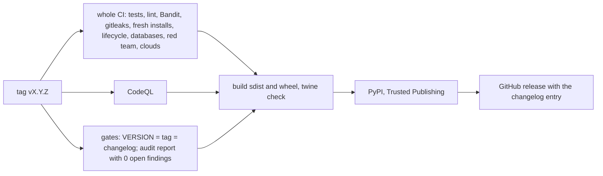

# Releasing

A release reaches PyPI only through `.github/workflows/release.yml`, and only after every
gate passes on the tagged commit. Nothing is published by hand.



## Steps

1. Everything for the release is merged to `main` through pull requests (CI green).
2. `VERSION` holds the new version; the newest `CHANGELOG.md` entry is `## [X.Y.Z] - date`.
3. **Security audit.** Run the
   [security-audit skill](https://github.com/cloudflare/security-audit-skill) in full
   audit mode on that commit with a coding agent (Claude Code: install the skill, then
   "security audit this codebase"). Fix every confirmed finding through pull requests,
   then write `docs/audits/X.Y.Z.md`:

   ```
   # Security audit X.Y.Z

   Commit: <the audited commit>
   Method: security-audit skill (cloudflare/security-audit-skill @ <its commit>), full audit mode
   Open confirmed findings: 0

   | ID | Severity | Where | Finding | Fixed in |
   |---|---|---|---|---|
   ...

   ## Needs validation
   ...
   ```

   The release refuses to publish without this file or without the exact line
   `Open confirmed findings: 0`.
4. `git tag -a vX.Y.Z -m "host-guard X.Y.Z"` on that commit, then `git push origin vX.Y.Z`.
5. The workflow runs every gate, publishes, and makes the GitHub release.

## One-time PyPI setup

On pypi.org: Account settings, Publishing, "Add a new pending publisher", GitHub tab:

| Field | Value |
|---|---|
| PyPI Project Name | `host-guard` |
| Owner | `855princekumar` |
| Repository name | `host-guard` |
| Workflow name | `release.yml` |
| Environment name | `pypi` |

The GitHub environment `pypi` exists and deploys only from tags `v*.*.*`. No token is
stored anywhere: PyPI trusts this workflow through OpenID Connect, and every file is
published with a signed attestation of where it was built.

## If a gate fails

Nothing is published. Fix it through a pull request, move the tag to the fixed commit
(`git tag -d vX.Y.Z; git push origin :refs/tags/vX.Y.Z`, then tag again) before anything
reached PyPI, or release X.Y.Z+1. A version that reached PyPI is never replaced.
