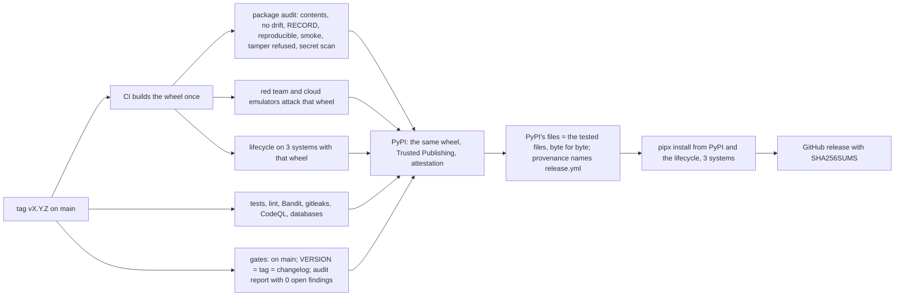

# Releasing

A release reaches PyPI only through `.github/workflows/release.yml`, and only after every
gate passes on the tagged commit. Nothing is published by hand.



## The package is the thing tested

| Check | Where | What it proves |
|---|---|---|
| Contents | `ci/package_audit.py` | only `host_guard/` and its metadata; no tests, bytecode, `.pth` file, key, database, `.env` or git folder |
| No drift | `ci/package_audit.py` | every shipped file is byte-for-byte the repository's, and nothing that should ship is missing |
| RECORD | `ci/package_audit.py` | every file has the SHA-256 its RECORD lists |
| Metadata | `ci/package_audit.py` | name, version, Python 3.10+, MIT, the project URL, one entry point, **no dependencies at all** (nothing to confuse or typosquat) |
| Archives | `ci/package_audit.py` | no absolute path, `..`, link, device, setuid or world-writable file |
| Reproducible | `ci/package_audit.py --rebuild` | a second build from the same commit is bit for bit the same file |
| Tamper refused | `ci/package_audit.py --smoke`, red team PKG-1, PKG-2 | the version manager checks its files against RECORD before anything runs as root: a changed or added file stops it |
| Secrets | package job | gitleaks over everything the wheel and sdist carry |
| Attacked | red team, clouds | the red team installs that wheel with pipx and attacks it (46 attacks plus 5 on the package); the cloud emulators run its `hostguard` |
| Published = tested | `ci/verify_pypi.py` | PyPI's files and the files its host serves have the tested SHA-256s; each has a provenance attestation from this repository's `release.yml` |
| Installable | release `from-pypi` | `pipx install host-guard==X.Y.Z` from the index, then the whole lifecycle with PyPI's file, on Ubuntu 24.04, 26.04 and Debian 12 |

If `verify` or `from-pypi` fails after publishing, yank the release on pypi.org at once
and find out why: the files on PyPI are then not the files that were tested.

Check a download yourself: the GitHub release carries `SHA256SUMS`; `sha256sum -c SHA256SUMS`
next to the files, or compare with the hashes on the PyPI page.

## Steps

1. Everything for the release is merged to `main` through pull requests (CI green).
2. `VERSION` holds the new version; the newest `CHANGELOG.md` entry is `## [X.Y.Z] - date`.
3. **Security audit.** Run the
   [security-audit skill](https://github.com/cloudflare/security-audit-skill) in full
   audit mode on that commit with a coding agent (Claude Code: install the skill, then
   "security audit this codebase"). Fix every confirmed finding through pull requests,
   then write `docs/audits/X.Y.Z.md`:

   ```
   # Security audit X.Y.Z

   Commit: <the audited commit>
   Method: security-audit skill (cloudflare/security-audit-skill @ <its commit>), full audit mode
   Open confirmed findings: 0

   | ID | Severity | Where | Finding | Fixed in |
   |---|---|---|---|---|
   ...

   ## Needs validation
   ...
   ```

   The release refuses to publish without this file or without the exact line
   `Open confirmed findings: 0`.
4. `git tag -a vX.Y.Z -m "host-guard X.Y.Z"` on that commit, then `git push origin vX.Y.Z`.
5. The workflow runs every gate, publishes the tested files, checks what PyPI serves,
   installs it from PyPI on three systems, and makes the GitHub release.

## One-time PyPI setup

On pypi.org: Account settings, Publishing, "Add a new pending publisher", GitHub tab:

| Field | Value |
|---|---|
| PyPI Project Name | `host-guard` |
| Owner | `855princekumar` |
| Repository name | `host-guard` |
| Workflow name | `release.yml` |
| Environment name | `pypi` |

The GitHub environment `pypi` exists and deploys only from tags `v*.*.*`. No token is
stored anywhere: PyPI trusts this workflow through OpenID Connect, and every file is
published with a signed attestation of where it was built.

## If a gate fails

Nothing is published. Fix it through a pull request, move the tag to the fixed commit
(`git tag -d vX.Y.Z; git push origin :refs/tags/vX.Y.Z`, then tag again) before anything
reached PyPI, or release X.Y.Z+1. A version that reached PyPI is never replaced.
